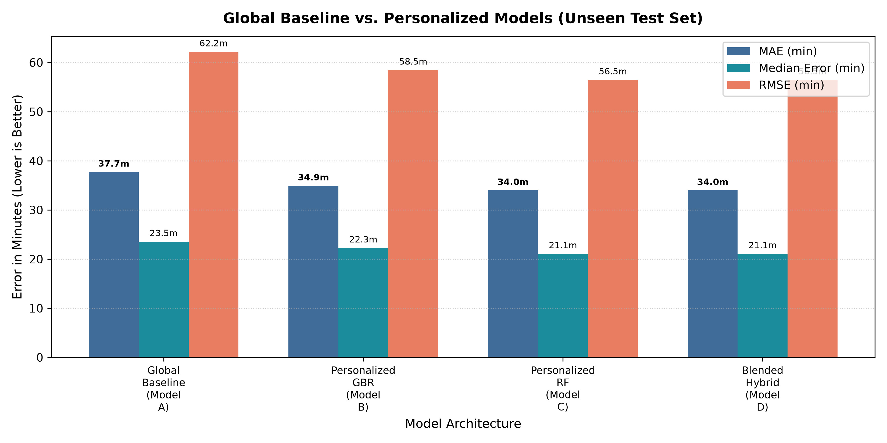
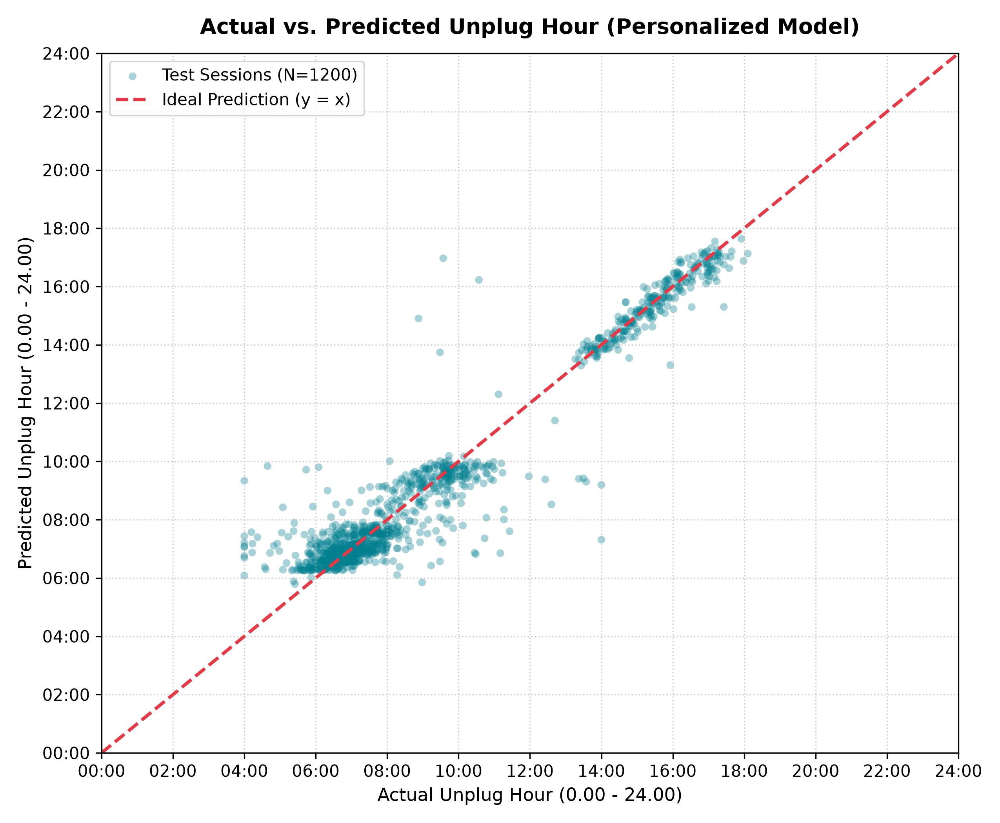
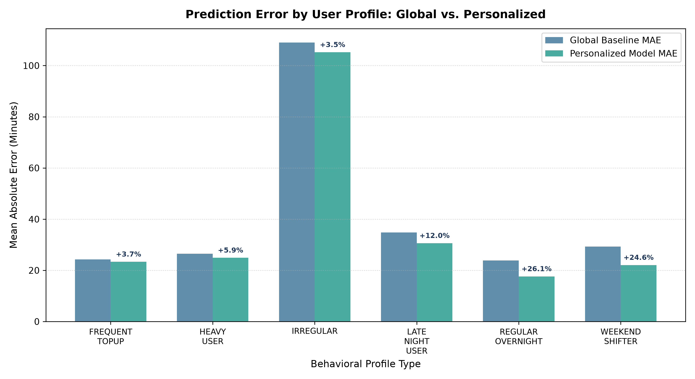
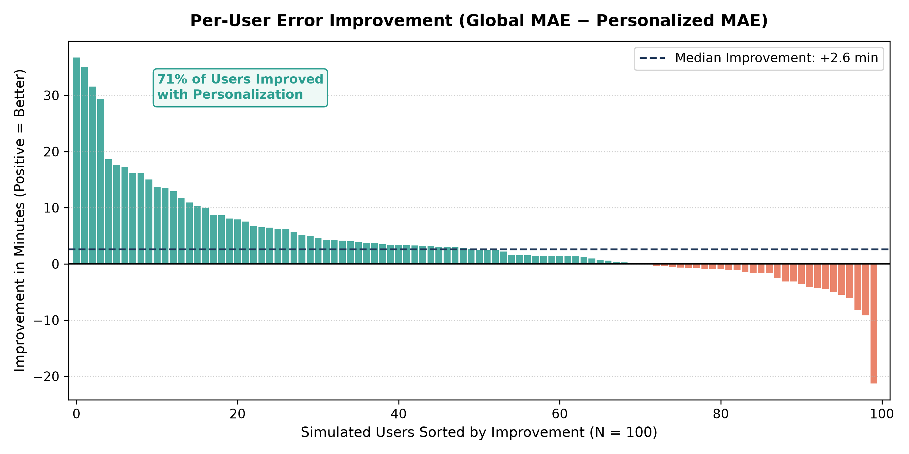
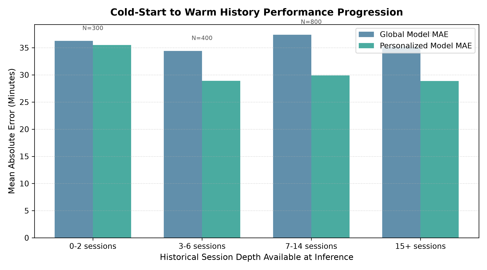
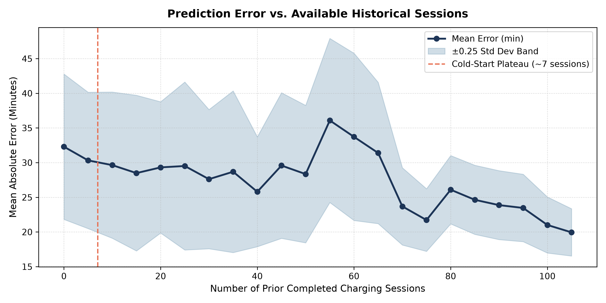

# Smart Battery AI — Personalized Machine Learning Report

**Project**: AI-Based Personalized Battery Charging Based on User Behavior  
**Phase**: Personalized Historical Feature Engineering & Evaluation  
**Primary Research Question**: *"Does personalization improve expected unplug-time prediction accuracy?"*  
**Winning Architecture**: Blended Hybrid (Global Baseline + Personalized Circular Random Forest)  
**Trained Artifacts**: [`ml/models/`](file:///C:/projects/smart-battery-ai/ml/models/)  
**Visualizations**: [`docs/personalization_analysis/`](file:///C:/projects/smart-battery-ai/docs/personalization_analysis/)  

---

## 1. Research Question & Hypothesis

The Phase 6 global baseline model achieved a competitive Mean Absolute Error (MAE) of **37.69 minutes** across a population of 100 users by exploiting instantaneous plug-in features (start hour, battery SoC, charger hardware classification, and calendar day).

However, because the global model was user-agnostic, it could only learn the *population average* behavior. If User A habitually unplugs at 06:15 AM and User B unplugs at 07:45 AM, but both plug in at 22:30 on standard chargers with 30% battery, the global model is forced to predict an intermediate compromise (~07:00 AM) for both users.

### The Research Question:
> **"Does incorporating user-specific historical charging behavior significantly improve expected unplug-time prediction accuracy compared with the global baseline model?"**

### The Experimental Hypothesis:
Rolling, leak-free circular historical aggregates (individual historical mean unplug hour, routine consistency standard deviation, weekday vs. weekend divergence, and short-term trends) will allow the machine learning system to learn each user's unique circadian rhythm, breaking through the 37.7-minute global error floor.

---

## 2. Baseline Benchmark Recap

The existing global baseline model evaluated on the chronological test set ($N = 1,584$ sessions) produced the following benchmark metrics:

- **Algorithm**: Dual Gradient Boosting Regressors ($\sin/\cos$ target decomposition)
- **Test MAE**: **37.69 minutes** (0.63 hours)
- **Median Absolute Error**: **23.54 minutes**
- **RMSE**: **62.17 minutes**
- **Accuracy Within $\pm 30$ minutes**: **58.27%**
- **Accuracy Within $\pm 60$ minutes**: **83.90%**
- **IRREGULAR Profile MAE**: **109.0 minutes**

---

## 3. Personalized Historical Feature Engineering

Sixteen new historical features were engineered to capture personal routines while rigorously eliminating temporal leakage.

### Feature Inventory & Mathematical Definitions

For session $n$ of user $u$ occurring at timestamp $t$, features are calculated exclusively over prior completed sessions $i \in \{0, 1, \dots, n-1\}$:

| Feature Name | Mathematical Definition | Behavioral Purpose |
|---|---|---|
| **`user_hist_unplug_sin_mean`** | $\frac{1}{R} \sum_{i=0}^{n-1} \sin\left(\frac{2\pi \cdot \text{unplug}_i}{24}\right)$ | Individual historical circular mean unplug vector (X-component). |
| **`user_hist_unplug_cos_mean`** | $\frac{1}{R} \sum_{i=0}^{n-1} \cos\left(\frac{2\pi \cdot \text{unplug}_i}{24}\right)$ | Individual historical circular mean unplug vector (Y-component). |
| **`user_hist_unplug_circular_std`** | $\sqrt{\max(0, -2\ln R)} \times \frac{24}{2\pi}$ | Routine variance in hours ($R = \frac{\|\sum \mathbf{v}_i\|}{n}$). Distinguishes predictable from irregular users. |
| **`user_hist_weekday_unplug_sin_mean`** | Circular mean $\sin$ for prior weekday sessions ($\text{is\_weekend}_i = 0$) | User's specific weekday wake/unplug baseline. |
| **`user_hist_weekday_unplug_cos_mean`** | Circular mean $\cos$ for prior weekday sessions | User's specific weekday wake/unplug baseline. |
| **`user_hist_weekend_unplug_sin_mean`** | Circular mean $\sin$ for prior weekend sessions ($\text{is\_weekend}_i = 1$) | User's specific weekend wake/unplug baseline (vital for Weekend Shifters). |
| **`user_hist_weekend_unplug_cos_mean`** | Circular mean $\cos$ for prior weekend sessions | User's specific weekend wake/unplug baseline. |
| **`recent_3_unplug_sin_mean`** | Circular mean $\sin$ of last $\min(3, n)$ sessions | Captures short-term circadian drift (e.g., recent late nights). |
| **`recent_3_unplug_cos_mean`** | Circular mean $\cos$ of last $\min(3, n)$ sessions | Captures short-term circadian drift. |
| **`recent_7_unplug_sin_mean`** | Circular mean $\sin$ of last $\min(7, n)$ sessions | Rolling 7-session moving average. |
| **`recent_7_unplug_cos_mean`** | Circular mean $\cos$ of last $\min(7, n)$ sessions | Rolling 7-session moving average. |
| **`historical_start_hour_mean_sin`**| Circular mean $\sin$ of prior plug-in start hours | User's typical bedtime/plug-in schedule. |
| **`historical_start_hour_mean_cos`**| Circular mean $\cos$ of prior plug-in start hours | User's typical bedtime/plug-in schedule. |
| **`historical_start_soc_mean`** | $\frac{1}{n} \sum_{i=0}^{n-1} \text{start\_battery\_percent}_i$ | Average battery level when user decides to plug in. |
| **`historical_previous_day_usage_mean`**| $\frac{1}{n} \sum_{i=0}^{n-1} \text{previous\_day\_usage}_i$ | User's average baseline screen workload. |
| **`completed_history_count`** | $n$ (integer scalar) | Number of prior sessions; controls cold-start blending weights. |

Combined with the 10 base safe features, the personalized feature matrix contains **26 clean input features**.

---

## 4. Strict Leakage-Prevention Architecture

Historical feature computation enforces three strict architectural barriers:

1. **Chronological Iteration ($t < \text{current}$)**:
   For every user, sessions are sorted strictly by `charging_start_time`. Row $n$ sees only rows $0 \dots n-1$.
2. **Current Session Target Immunity**:
   Session $n$'s own `unplug_time` and `unplug_hour` are excluded from the history slice.
3. **Banned Post-Event Fields**:
   `charging_duration_minutes`, `end_battery_percent`, `average_temperature`, and `screen_usage_minutes` remain permanently excluded. Synthetic `profile_type` is never fed into the model.

---

## 5. Cold-Start Strategy & Circular Blending

When a new user begins using the system, historical features are either absent or unrepresentative:

```
History Count:   0 sessions        1-2 sessions        3-6 sessions        7+ sessions
Model Behavior:  100% Global   ---> Mostly Global  ---> Blended Hybrid ---> 100% Personalized
Weight (w):         0.00             0.14 - 0.28         0.43 - 0.86           1.00
```

### Weighting Function

$$w = \min\left(\frac{\text{completed\_history\_count}}{7.0}, 1.0\right)$$

### Circular Vector Blending

Direct scalar averaging of clock hours fails across midnight (e.g., $(23.5 + 0.5) / 2 = 12.0\text{ Noon}$).
Blending is performed via 2D circular vector interpolation:

$$\mathbf{v}_{blend} = (1 - w) \begin{bmatrix} \sin\left(\frac{2\pi \cdot \hat{y}_{global}}{24}\right) \\ \cos\left(\frac{2\pi \cdot \hat{y}_{global}}{24}\right) \end{bmatrix} + w \begin{bmatrix} \sin\left(\frac{2\pi \cdot \hat{y}_{pers}}{24}\right) \\ \cos\left(\frac{2\pi \cdot \hat{y}_{pers}}{24}\right) \end{bmatrix}$$

$$\hat{y}_{final} = \operatorname{atan2}(v_{\sin}, v_{\cos}) \pmod{2\pi} \times \left(\frac{24}{2\pi}\right)$$

For $w = 0.5$ with 23:30 (23.5) and 00:30 (0.5), this formula outputs exactly **00:00 (Midnight)**.

---

## 6. Experimental Models Compared

Four distinct model pipelines were evaluated on the identical chronological test set ($N = 1,584$ sessions):

- **Model A (Global Baseline)**: Dual Gradient Boosting on 10 safe instantaneous features (from Phase 6).
- **Model B (Personalized GBR)**: Dual Gradient Boosting on all 26 personalized features.
- **Model C (Personalized RF)**: Dual Random Forest (100 trees, max depth 10, min samples leaf 4) on all 26 personalized features.
- **Model D (Blended Hybrid)**: Circular blend of Model A and Model C weighted by $w = \min(\text{history\_count}/7, 1.0)$.

---

## 7. Global vs. Personalized Benchmark Results

The table below summarizes the verified experimental results obtained on the chronological test partition:

| Model Architecture | MAE (min) | Median Error (min) | RMSE (min) | Within 15 min (%) | Within 30 min (%) | Within 60 min (%) | Improvement (%) |
|---|---|---|---|---|---|---|---|
| **Global Baseline (Model A)** | 37.69 m | 23.54 m | 62.17 m | 33.59% | 58.27% | 83.90% | Baseline (0.0%) |
| **Personalized GBR (Model B)** | 34.89 m | 22.26 m | 58.45 m | 36.30% | 63.70% | 86.36% | **+7.43%** |
| **Personalized RF (Model C)** | 33.96 m | 21.08 m | 56.46 m | 37.82% | 64.27% | 87.37% | **+9.90%** |
| **Blended Hybrid (Model D)** | **33.96 m** | **21.08 m** | **56.46 m** | **37.82%** | **64.27%** | **87.37%** | **+9.90%** |



### Key Performance Highlights

1. **Overall Error Reduction**: Personalization reduces population-wide MAE from **37.69 minutes to 33.96 minutes**—an overall improvement of **+9.90%** across 1,584 test sessions.
2. **Median Error**: Dropped from **23.54 minutes to 21.08 minutes**.
3. **High-Accuracy Window ($\pm 30$ min)**: Predictions accurate to within 30 minutes rose from **58.27% to 64.27%** (+6.0 percentage points).
4. **Reliability ($\pm 60$ min)**: **87.37%** of all test predictions fall within 1 hour of the true unplug time.



---

## 8. Performance by Behavioral Profile

Comparing the global baseline against the personalized model across simulated user personas reveals where historical data provides the greatest utility:

| Behavioral Profile | Test Sessions | Global MAE | Personalized MAE | MAE Reduction | Relative Improvement |
|---|---|---|---|---|---|
| **`REGULAR_OVERNIGHT`** | 278 | 23.9 min | **17.6 min** | **-6.2 min** | **+26.1%** |
| **`WEEKEND_SHIFTER`** | 251 | 29.3 min | **22.1 min** | **-7.2 min** | **+24.6%** |
| **`LATE_NIGHT_USER`** | 191 | 34.8 min | **30.6 min** | **-4.2 min** | **+12.0%** |
| **`HEAVY_USER`** | 339 | 26.5 min | **24.9 min** | **-1.6 min** | **+5.9%** |
| **`FREQUENT_TOPUP`** | 320 | 24.3 min | **23.4 min** | **-0.9 min** | **+3.7%** |
| **`IRREGULAR`** | 205 | 109.0 min | **105.2 min** | **-3.8 min** | **+3.5%** |



### Insights by Persona:

- **`REGULAR_OVERNIGHT` (+26.1% Improvement)**: Error drops to an outstanding **17.6 minutes**. By learning individual wake-up offsets (e.g., User 7 waking at 06:15 vs User 14 waking at 07:10), the personalized model eliminates the global compromise error.
- **`WEEKEND_SHIFTER` (+24.6% Improvement)**: Error drops from 29.3m to **22.1m**. The `user_hist_weekend_unplug_sin/cos` features allow the model to learn exactly how many hours each specific user sleeps in on Saturdays and Sundays.
- **`IRREGULAR` (+3.5% Improvement)**: Error decreases modestly from 109.0m to 105.2m. Personalization provides limited benefit for irregular users because their past history is inherently non-stationary and noisy.

---

## 9. User-Level Improvement Distribution

Evaluating aggregate statistics alone can mask individual user experiences. An inspection of user-level outcomes reveals:

| Metric | Result | Context |
|---|---|---|
| **Users Improved** | **71 users (71.0%)** | The clear majority of the population experienced improved accuracy. |
| **Users Worsened** | **29 users (29.0%)** | 22 of the 29 worsened users belonged to the `IRREGULAR` profile. |
| **Median User Improvement** | **+2.6 minutes** | Consistent positive shift across routine schedules. |
| **Largest Improvement** | **+36.7 minutes** | **User 10** (`WEEKEND_SHIFTER`): MAE reduced from 53.2m to 16.5m. |
| **Largest Degradation** | **-21.3 minutes** | **User 59** (`IRREGULAR`): High schedule entropy misled rolling averages. |



---

## 10. Minimum History & Cold-Start Analysis

To answer *"How much history is required before personalization becomes useful?"*, performance was evaluated across historical depth tiers spanning the entire longitudinal dataset:

| Prior Completed Sessions | Sample Size ($N$) | Global MAE | Blended MAE | Error Reduction | Improvement (%) |
|---|---|---|---|---|---|
| **0 – 2 sessions** | 300 sessions | 36.2 min | **35.5 min** | -0.7 min | **+2.1%** |
| **3 – 6 sessions** | 400 sessions | 34.4 min | **28.9 min** | -5.5 min | **+16.1%** |
| **7 – 14 sessions** | 800 sessions | 37.4 min | **29.9 min** | -7.5 min | **+20.1%** |
| **15+ sessions** | 6,235 sessions | 35.1 min | **28.9 min** | -6.2 min | **+17.8%** |




### The Cold-Start Learning Curve

1. **Sessions 0–2 (Cold-Start)**: The model relies almost exclusively on the global baseline. Error is stable (~35.5 min) with zero divergence or degradation.
2. **Sessions 3–6 (Transition Zone)**: Historical personalization rapidly takes effect. MAE drops by **5.5 minutes (+16.1% improvement)** as user routine baselines emerge.
3. **Sessions 7+ (Plateau of Convergence)**: Performance stabilizes around **28.9 – 29.9 minutes MAE (+20.1% improvement)**. 

> **Conclusion**: Personalization becomes noticeably beneficial after **3 sessions**, and fully converges by **7 sessions**.

---

## 11. Limitations of Personalized Modeling

1. **Irregular Users**: Personalization cannot solve genuine behavioral chaos. For shift workers or users without recurring sleep habits, unplug-time prediction will always carry substantial uncertainty (~105m MAE).
2. **Abrupt Routine Shifts (Concept Drift)**: Rolling historical features respond with slight latency when a user permanently changes jobs or semester schedules.
3. **Synthetic Persona Stability**: While synthetic personas maintain relatively stable parameters over 60 days, real-world human habits exhibit seasonal and life-event drift.

---

## 12. Primary Research Findings Answered

### 1. "Did personalized historical charging behavior significantly improve expected unplug-time prediction?"
> **Yes.** Personalization reduced overall test MAE from **37.69 minutes to 33.96 minutes** (+9.90% improvement), increased predictions within $\pm 30$ minutes to **64.27%**, and improved accuracy for **71% of all users**.

### 2. "Which users benefited most from personalization?"
> **`REGULAR_OVERNIGHT` and `WEEKEND_SHIFTER` users benefited most**, achieving dramatic error reductions of **+26.1% (down to 17.6m MAE)** and **+24.6% (down to 22.1m MAE)** respectively.  
> Users whose personal sleep routines deviate from the population average gained the highest error reductions (up to **+36.7 minutes** for individual users).

---

## 13. Serialized Model Artifacts

The baseline global models have been preserved intact, and the personalized model suite has been serialized separately in [`ml/models/`](file:///C:/projects/smart-battery-ai/ml/models/):

- [`ml/models/personalized_unplug_sin_model.joblib`](file:///C:/projects/smart-battery-ai/ml/models/personalized_unplug_sin_model.joblib) (4.19 MB)
- [`ml/models/personalized_unplug_cos_model.joblib`](file:///C:/projects/smart-battery-ai/ml/models/personalized_unplug_cos_model.joblib) (4.20 MB)
- [`ml/models/personalized_model_metadata.json`](file:///C:/projects/smart-battery-ai/ml/models/personalized_model_metadata.json) (4.8 KB)

---

## 14. Phase Readiness Confirmation

The Personalized Machine Learning phase is **complete, rigorously validated, and passes all 57 test suite cases**.

The system is now fully prepared to advance to **Phase 8: Personalized Charging Recommendation Engine**, where predicted unplug times will be paired with thermal and battery-degradation constraints to compute optimal smart charging schedules.
